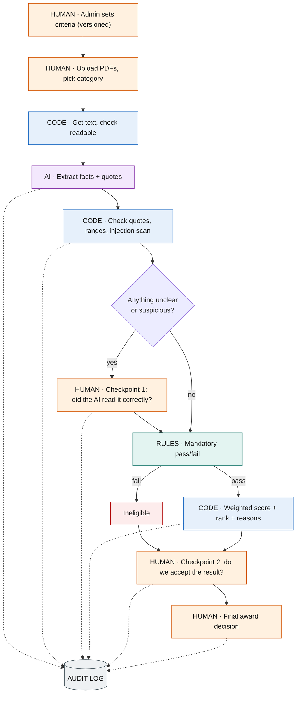

# AI Proposal Triage: Design Submission

| | |
|---|---|
| **Name** | `Salwa Ansari` |
| **Reference** | MATACS-TH-2026-02 |
| **Role** | Associate Software Developer |
| **Time actually spent** | `40 mins` |

## Files

| File | What it is |
|---|---|
| [WRITEUP.md](WRITEUP.md) | Answers to the five questions |
| [diagram/process-flow.png](diagram/process-flow.png) | Process flow from upload to ranked output: AI steps, rule steps, human checkpoints, audit log |
| [PROMPTS.md](PROMPTS.md) | The extraction prompt exactly as sent, expected JSON, and the checks code runs on the answer |
| [ranking.json](ranking.json) | Expected ranking of proposals A–E |
| [prototype/](prototype/README.md) | *Optional:* a short script that applies the rules and produces `ranking.json` |
| [.env.example](.env.example) | Placeholder for API keys (none are committed) |

## The design in 30 seconds

**AI reads. Code and rules decide. People approve.**

1. **AI** turns each proposal's free text into a fixed set of facts (price, weeks, who holds the licence…), and quotes the sentence each fact came from. It never scores or ranks.
2. **Code** checks those quotes really exist in the document, then applies the admin's pass/fail rules and weights. Same inputs always give the same ranking.
3. Anything uncertain (a missing value, an unclear statement, hidden text aimed at the AI) is **flagged for a person**, not guessed.
4. **People** confirm the facts, review the ranking, can override with a written reason, and make the award. Everything is logged.

## Result for the sample proposals

| | Status | Score | Why |
|---|---|---|---|
| **A** | Ranked 1st | 98.0 | Full marks on experience, timeline and team; small gaps on price and warranty |
| **E** | Ranked 2nd | 91.7 | Best warranty and a complete team plan, but fewer installs (8) |
| **C** | Flagged | 84.8 (provisional) | Contains hidden text telling automated reviewers to rank it first. It's ignored in scoring and sent to a person. Its installs also reach back to 2020, outside the 5-year window. |
| **D** | Flagged | 76.3 (provisional) | No committed timeline, so it can't be checked against the 16-week limit. The reviewer should ask for one. |
| **B** | Ineligible | — | Cheapest and fastest, but the electrical licence belongs to a subcontractor still to be confirmed, not to B. Fails a mandatory check. |

Flagged proposals keep a provisional score so the reviewer can see where they would land. They join the ranking only once a person resolves the flag.

## Process at a glance

## How I used AI tools

I used Claude (in Claude Code) to help draft the documents, the diagram and the scoring script from my design decisions, and I reviewed every file and re-ran the script to check the scores. **Where I disagreed:** the AI-generated plan I started from asked for an AI scoring prompt and a numeric "confidence score" for each extracted fact. I dropped both. Scoring is arithmetic that code does exactly and repeatably, and a model's self-reported confidence isn't reliable. So the AI only extracts, and each fact carries a quote that code checks against the document.
